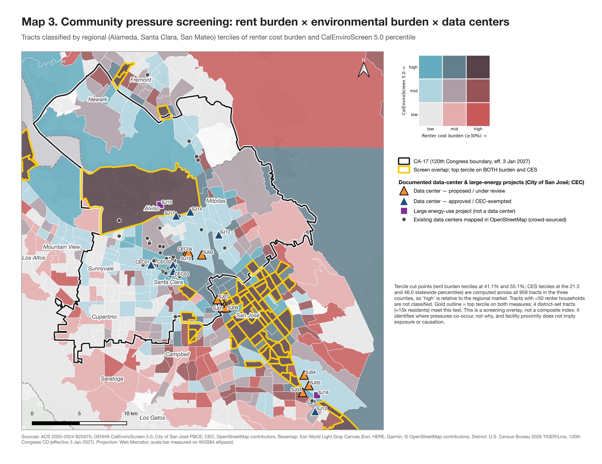
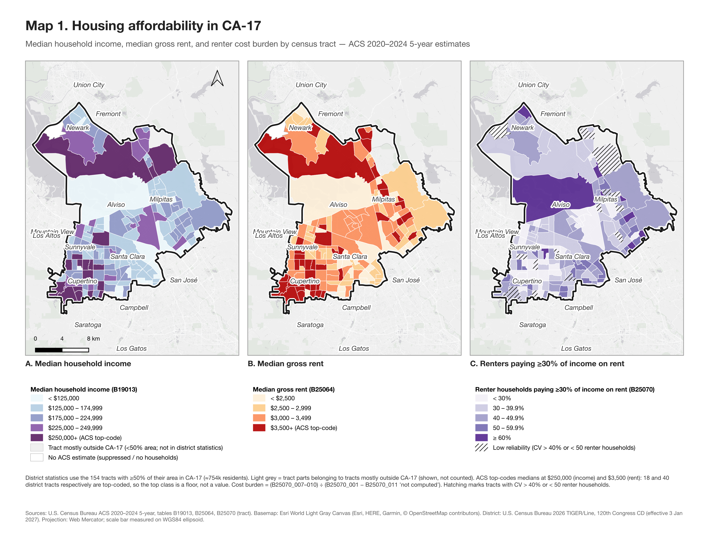
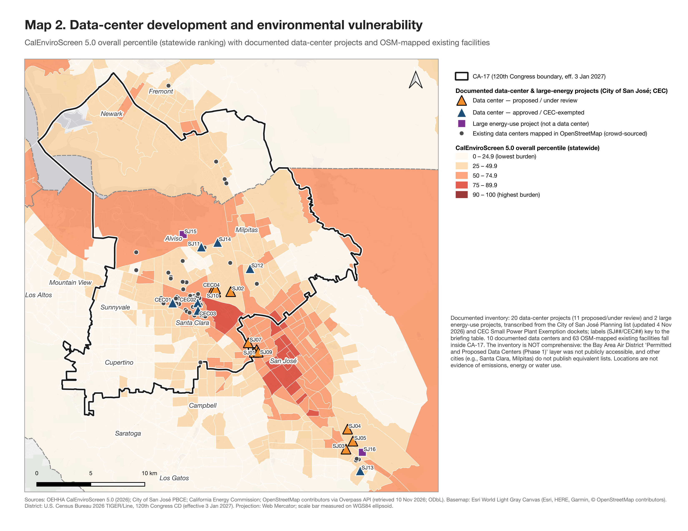

# Technology Growth and Community Costs in Silicon Valley

**Where data-center development, housing-cost pressure and environmental burden overlap in California's 17th Congressional District**

*Spandan Gandhi · The George Washington University · November 2026*

An independent geospatial policy analysis of CA-17 as drawn for the **120th Congress (boundary effective 3 January 2027)**. It combines American Community Survey housing data, CalEnviroScreen 5.0, and a facility inventory built from official City of San José and California Energy Commission records. The output is a short brief for congressional staff, backed by a fully reproducible QGIS/Python workflow.

📄 **[Read the 4-page policy brief (PDF)](docs/CA17_Policy_Brief.pdf)** · 📑 **[Methods appendix (PDF)](docs/CA17_Methods_Appendix.pdf)** · 🗺️ **[QGIS project](qgis/CA17_Tech_Housing.qgz)**



---

## Key findings

| | |
|---|---|
| **Renter cost burden** | 36.8% (±1.3) of the district's renter households pay ≥30% of income on rent, and 16.8% (±0.9) pay ≥50%. That is below Santa Clara County (45.0%) and California (55.3%), and concentrated in the district's Newark and San José tracts. |
| **Environmental burden** | The district's CalEnviroScreen profile is driven by pollution sources, not population vulnerability. Tract medians sit at the 77th statewide percentile for groundwater threats, 73rd for traffic and 71st for hazardous waste. Only 2 tracts rank in the state's most-burdened quartile overall. |
| **Data-center concentration** | 63 of the 76 existing data centers mapped in OpenStreetMap across Alameda, Santa Clara and San Mateo counties lie inside CA-17. So do 10 of 20 documented proposed or approved projects (4 under review), typically sized at 90–99.8 MW of backup generation or peak load. |
| **Co-location, not causation** | Tracts hosting data centers have a median pollution-burden percentile of 84, against 44 for other district tracts. This reflects shared industrial land and legacy contamination, not a measured data-center effect. |
| **Data gap** | The Bay Area Air District's permitted-and-proposed data-center inventory is not publicly accessible. No public regional register links facility locations to generator permits or electricity demand. |

## Maps

| Map 1 — Housing affordability | Map 2 — Data centers & CalEnviroScreen |
|---|---|
|  |  |

High-resolution PDFs: [Map 1](maps/Map1_Housing_Affordability.pdf) · [Map 2](maps/Map2_DataCenters_Environment.pdf) · [Map 3](maps/Map3_Community_Pressure_Screening.pdf)

## Approach

1. **Data audit.** Every input was checked before use. Two supplied housing workbooks turned out to be byte-identical extracts for a city outside the district, so they were excluded. The draft energy-affordability file was used for context only. The Air District's data-center layer was access-controlled and was not bypassed.
2. **Geography.** 202 tracts intersect CA-17. Overlap shares were computed in an equal-area projection (EPSG:3310), and the **154 tracts with ≥50% of their area inside the district** form the analysis set. They hold ≈754k residents, close to California's ≈760k equal-population target. The other tracts are retained and flagged, never dropped.
3. **Housing.** ACS 2020–2024 B19013, B25064 and B25070. Cost burden uses the computed-ratio denominator (B25070_001 − 011). Margins of error follow Census Bureau formulas, reliability is flagged by coefficient of variation, and top-coded medians are labelled as floors.
4. **Environment.** CalEnviroScreen 5.0 overall, pollution-burden and population-characteristic percentiles, plus indicator-level profiles.
5. **Facilities.** A documented inventory of 22 records (20 data centers, 2 large energy-use projects). Each keeps its permit or docket ID and source URL and is geocoded with the U.S. Census Geocoder. OpenStreetMap supplies existing facilities as clearly labelled context.
6. **Screening.** A transparent 3×3 bivariate classification (regional terciles of rent burden × CalEnviroScreen) with facility overlay and 1 km proximity estimates. There is no composite index and no causal claim.

## Repository structure

```
docs/            policy brief + methods appendix (PDF)
maps/            three finished maps (300-dpi PNG + vector PDF)
qgis/            QGIS project: grouped layers, symbology, 3 print layouts, relative paths
scripts/         numbered, reproducible pipeline (PyQGIS / GeoPandas / ReportLab)
data/raw/        original inputs as supplied (see data/raw/SOURCES.md)
data/external/   retrieved sources: transcribed facility inventory, geocode cache, OSM query results,
                 ArcGIS access-attempt responses
data/processed/  analysis GeoPackages + validation and summary tables
logs/            console output from each pipeline step
```

**Main layers** (`data/processed/ca17_analysis.gpkg`): `ca17_district_120th`, `ca17_tracts_analysis` (202 tracts with overlap class, ACS estimates and MOEs, CES 5.0, screening classes), `region_tracts_3county` (959 tracts), `facilities_documented`, `datacenters_osm_existing`.

## Reproduce

Requires QGIS ≥ 3.40 (macOS paths shown) and its bundled Python.

```bash
source scripts/env.sh
$QGIS_APP/MacOS/python -m pip install --target scripts/_pylib openpyxl reportlab pypdf   # then delete scripts/_pylib/PIL if pip installs it
bash scripts/00_extract.sh                               # unzip ACS + CalEnviroScreen archives
$QGIS_APP/MacOS/python scripts/01_prepare_data.py        # geography, overlap, joins, validation
$QGIS_APP/MacOS/python scripts/02_facilities.py          # geocoding, OSM, proximity
$QGIS_APP/MacOS/python scripts/03_summary_stats.py       # statistics -> summary_stats.json
bash scripts/04_cache_basemap.sh                         # cache Esri Light Gray Canvas locally (not redistributed)
$QGIS_APP/MacOS/python scripts/04b_city_labels.py        # map labels
$QGIS_APP/MacOS/python scripts/05_build_qgis_project.py  # QGIS project, layouts, map exports
$QGIS_APP/MacOS/python scripts/06_build_briefing.py      # policy brief
$QGIS_APP/MacOS/python scripts/07_build_appendix.py      # methods appendix
```

Run `04_cache_basemap.sh` before opening the QGIS project; otherwise switch on the *live XYZ* basemap layer. Network lookups are cached in `data/external/`, so reruns reproduce the published numbers.

## Limitations

The facility inventory is **partial**. It covers City of San José applications and CEC exemption dockets; other cities publish no equivalent list, and the Air District inventory was inaccessible. ACS tract estimates carry wide margins of error and top-coding. CalEnviroScreen is a relative screening tool and does not measure data-center emissions, energy or water use. All findings describe geographic co-location only. See the [methods appendix](docs/CA17_Methods_Appendix.pdf) for the full list.

## Sources and licences

- U.S. Census Bureau: ACS 2020–2024 5-year estimates and 2026 TIGER/Line (public domain)
- California OEHHA: CalEnviroScreen 5.0
- City of San José PBCE: data-center applications list (updated 4 Nov 2026)
- California Energy Commission: power-plant listing, SPPE dockets, Energy Equity Indicators (draft)
- OpenStreetMap contributors: data © OpenStreetMap contributors, available under the [ODbL](https://opendatacommons.org/licenses/odbl/). Derived OSM layers in this repository are shared under the same licence.
- Basemap in the map images: Esri World Light Gray Canvas (Esri, HERE, Garmin, © OpenStreetMap contributors)

Code is released under the MIT licence (see `LICENSE`). Prepared by Spandan Gandhi (The George Washington University) as independent research, not produced by or for any government office or campaign.
